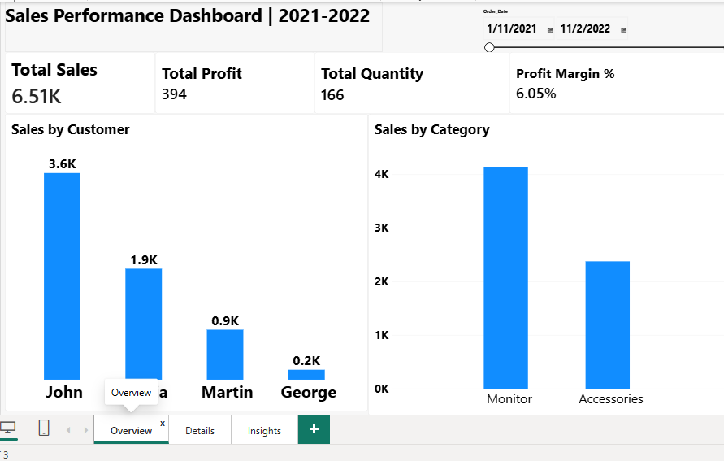
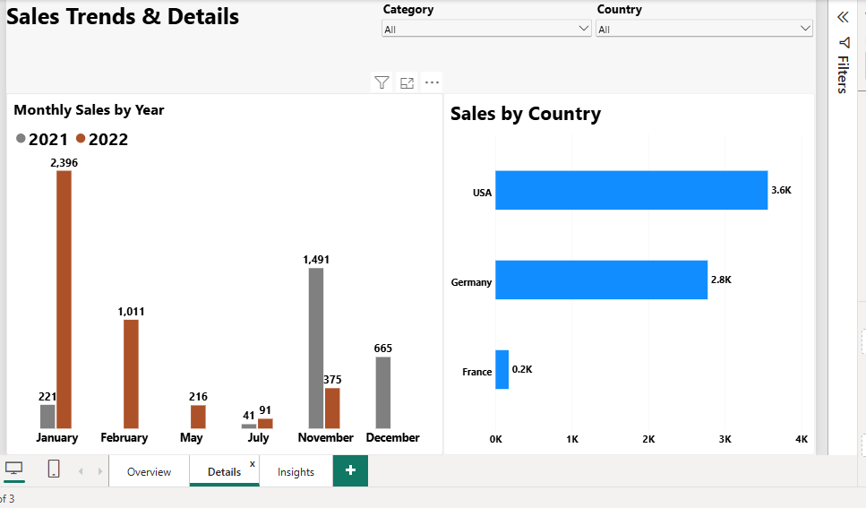
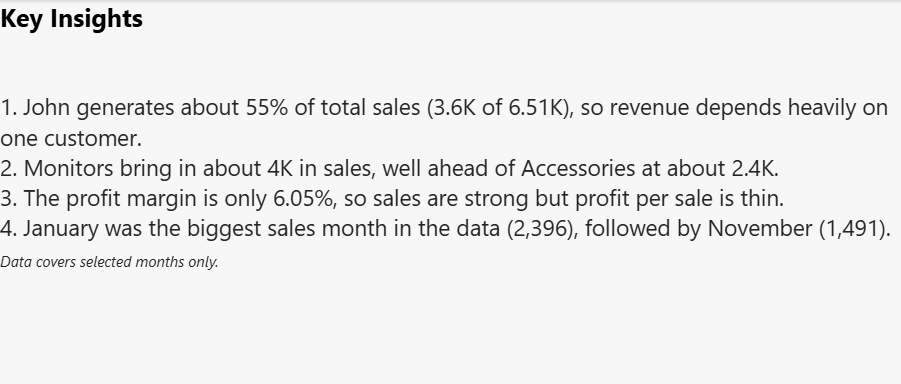
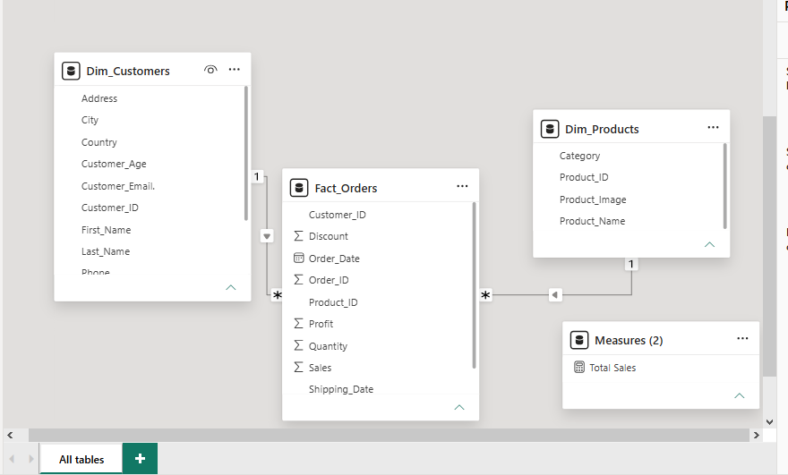

# Sales Performance Dashboard | 2021–2022

An interactive Power BI dashboard that analyses sales, profit and customer activity across products and countries.

## Business Question
Who and what drives sales, how profitable is it, and when do sales peak?

*Practice dataset.*

## Dashboard Preview

### Overview

### Details

### Key Insights

## Data Model
A star schema with one fact table and two dimension tables.

| Table | Type | Key fields |
|---|---|---|
| Fact_Orders | Fact | Order_ID, Order_Date, Customer_ID, Product_ID, Sales, Profit, Quantity, Discount |
| Dim_Customers | Dimension | Customer_ID, First_Name, Last_Name, Country, City |
| Dim_Products | Dimension | Product_ID, Product_Name, Category |

Relationships: Dim_Customers → Fact_Orders and Dim_Products → Fact_Orders (one-to-many).

## Key Metrics
- **Total Sales:** 6.51K
- **Total Profit:** 394
- **Total Quantity:** 166
- **Profit Margin %:** 6.05%

`Profit Margin % = DIVIDE(SUM(Fact_Orders[Profit]), SUM(Fact_Orders[Sales]))`

## Key Insights
1. John generates about 55% of total sales (3.6K of 6.51K), so revenue depends heavily on one customer.
2. Monitors bring in about 4K in sales, well ahead of Accessories at about 2.4K.
3. The profit margin is only 6.05%, so sales are strong but profit per sale is thin.
4. January 2022 (2,396), then November 2021 (1,491), were the biggest sales months in the data.

*Note: the data covers selected months only, so missing months are not zero sales.*

## Pages
- **Overview:** KPI cards, sales by customer, sales by category and a date slicer.
- **Details:** monthly sales by year, sales by country, with Category and Country slicers.
- **Insights:** a summary of the main findings.

## Tools Used
- Power BI Desktop
- DAX
- Power Query (data cleaning)

## Files
- `Sales.pbix` – the Power BI report
- `images/` – dashboard and data model screenshots

## What I Learned
- Building a star schema and relationships in Power BI
- Writing DAX measures
- Designing a clear multi-page dashboard and turning charts into insights

## Author
Orherime Betty Ejakpovi
